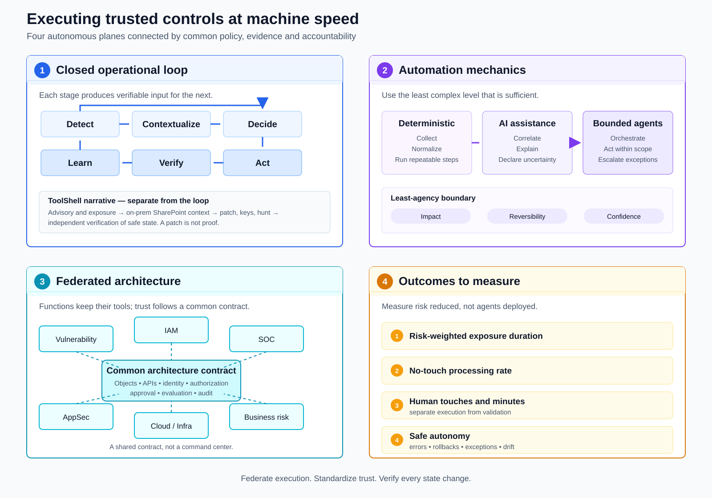

# Cybersecurity After Mythos: What Matters Now Is Not More Controls, but How We Execute Them

*Autonomous cyber models are changing the speed and scale of the problem. The answer is not another control framework, but a new system for executing the controls we already trust.*

The visual break around the Mythos announcement in [Epoch AI’s interactive explorer of published CVEs](https://epoch.ai/data/cve?view=graph) is hard to ignore. It is also easy to misread.

**This graph is a signal, not a curve of compromises.** Epoch plots CVE publication dates, not vulnerability discovery dates, exploit creation, attacks or successful breaches. Reporting practices vary among CVE Numbering Authorities, sometimes substantially. Epoch says the increase around Mythos coincides with its announcement and may partly reflect work done before that date; it does not establish Mythos as the single cause.

> **Interactive figure — CVE publication trends and the Mythos milestone**  
> [Open Epoch AI’s “Data on Cyber Vulnerabilities” explorer](https://epoch.ai/data/cve?view=graph). The explorer lets readers inspect the underlying publication trend and methodology directly.  
> *Credit: Epoch AI, “Data on Cyber Vulnerabilities,” [CC BY 4.0](https://creativecommons.org/licenses/by/4.0/), accessed August 26, 2026.*

The most useful counterweight comes from [VulnCheck’s analysis of the first half of 2026](https://www.vulncheck.com/blog/state-of-exploitation-1h-2026). Of 1,061 vulnerabilities attributed to AI-assisted discovery, 14—1.3%—had been confirmed as exploited in the wild, roughly the overall rate VulnCheck observed. Yet the median time from CVE publication to classification as a known exploited vulnerability fell from 120 days in 2025 to 80 days in the first half of 2026.

More CVEs do not automatically mean more attacks. But they do mean more signal to process, while the time available to decide what matters may be shrinking.

The principles of security have not become obsolete. The human, sequential, queue-based model used to execute them is becoming obsolete. ToolShell shows why. A closed execution loop shows what could replace it. Graduated autonomy shows how to make that change without surrendering control.

## Mythos is evidence of a capability shift

Mythos matters less as a product than as proof that a threshold has been crossed.

At the first level of evidence, there are laboratory claims. [Anthropic reports](https://www.anthropic.com/research/mythos-preview) that Claude Mythos Preview can discover and then exploit zero-day vulnerabilities in real codebases, and that researchers have used scaffolds to automate some exploit-development work without human intervention. Those are significant results, but they remain results published by the lab, under its evaluation conditions, with many findings still unavailable for independent review because of coordinated disclosure.

At the second level, there is a public, vendor-issued artifact. A [FreeBSD security advisory for CVE-2026-4747](https://www.freebsd.org/security/advisories/FreeBSD-SA-26:08.rpcsec_gss.asc) credits “Nicholas Carlini using Claude, Anthropic.” The RPCSEC_GSS packet-validation flaw could permit remote code execution in particular kernel or userspace configurations. The advisory does not prove every broader Mythos claim, but it makes at least one discovery, its attribution and its technical conditions publicly inspectable.

At the third level, reproducible research points to falling cost and time for known-vulnerability reproduction. In a preprint, the authors of [CVE-Genie](https://arxiv.org/html/2509.01835v2) report reproducing 428 of 841 CVEs—about 51%—with verifiable exploits. They report an average cost of $2.77 per CVE and about 18 minutes for a successful reproduction. Discovery and reproduction are not the same, and neither guarantees operational exploitation. Still, these results matter because they compress work that has traditionally required scarce expertise and significant manual effort.

The shift is not limited to Anthropic. Under its own Preparedness Framework, [OpenAI classifies GPT-5.5’s cybersecurity capability as “High,” while below “Critical”](https://deploymentsafety.openai.com/gpt-5-5/cybersecurity). That distinction is important: current models should not all be treated as autonomous, end-to-end operators. The direction of capability, however, is clear.

Two shocks follow. More vulnerabilities can be discovered or reproduced, and the cost and delay between information and a functional exploit can fall. The defender’s problem is becoming an asymmetry of throughput and time.

## The controls are not the bottleneck

Cybersecurity does not lack sensible outcomes. Across frameworks and operating models, the same four families keep returning:

1. know the assets, dependencies and exposure paths;
2. reduce access through least privilege, segmentation and Zero Trust principles;
3. remediate weaknesses or apply compensating controls;
4. detect, contain and prove a return to a safe state.

These remain valid. The title of this article is not an argument that *what* we do no longer matters. It is an argument that the control catalog is no longer the main source of differentiation. **We do not lack security principles. We lack an execution system capable of applying them at machine scale.**

Consider the normal queue. A periodic scan produces a finding. An analyst enriches it, searches for the owner, opens a ticket and hands it off. Another team arbitrates between CVSS, an SLA and competing production work. Someone approves a change. Someone else deploys it. A final person tries to verify and close it. Every transfer adds delay, loses context and invites local optimization.

Faster intake into that model only produces a faster-growing queue. The alternative is contextual prioritization: exploitation status, business criticality, exposure, attack path and compensating controls considered together. [CISA’s Stakeholder-Specific Vulnerability Categorization](https://www.cisa.gov/resources-tools/resources/stakeholder-specific-vulnerability-categorization-ssvc) is a useful example because it links evidence to response actions consistent with priorities approved by leadership, rather than treating a score as the decision.

Analysts should analyze exceptions, shape policy and validate outcomes—not act as technicians clicking through predictable workflows.

## ToolShell: why “apply the patch” is not enough

ToolShell was a chain targeting exposed, on-premises SharePoint servers. [CISA documented active exploitation](https://www.cisa.gov/news-events/alerts/2025/07/20/update-microsoft-releases-guidance-exploitation-sharepoint-vulnerabilities) that enabled access to SharePoint content and remote code execution, with potential machine-key theft, persistent modules and, in some cases, ransomware. [Microsoft reported multiple actors and post-exploitation activity](https://www.microsoft.com/en-us/security/blog/2025/07/22/disrupting-active-exploitation-of-on-premises-sharepoint-vulnerabilities), including web shells and persistence mechanisms.

ToolShell is **not** presented here as an AI-caused incident. It is a demonstration of the execution problem that accelerated cyber capabilities will make harder.

A credible response required coordinated actions: identify SharePoint instances, versions, internet exposure and owners; apply the relevant updates; enable or verify AMSI, antivirus and EDR; temporarily remove systems from exposure when they could not be protected; rotate ASP.NET machine keys and restart IIS; hunt for indicators and persistent modules; and confirm that the environment had actually returned to a safe state.

That sequence crosses vulnerability management, infrastructure, networking, IAM, the SOC, application ownership and business risk. No single ticket contains all the authority, data or tooling needed to complete it. Worse, an update can install successfully while a stolen key remains valid, a malicious module reloads, an exposed path persists or the service fails.

**A patch is an artifact. Remediation is a verified state change.**

The operational unit should therefore be neither the CVE nor the ticket. It should be the desired state—protected, unexposed where necessary, investigated, functional and evidenced—plus the policy-governed work required to reach it. The answer is not one smarter ticket. It is a closed execution loop.

## Close the execution loop

*Figure 2 — A federated execution model combines a six-step operating loop, three automation levels, a common trust contract and four measurable outcomes.*

The loop is **Detect → Contextualize → Decide → Act → Verify → Learn**. Each stage has a distinct purpose, evidence boundary and control point.

### 1. Detect

Continuously and deterministically ingest CVEs, KEV updates, vendor advisories, telemetry, inventory changes and exposure changes. AI can summarize and deduplicate, but it must preserve provenance rather than flatten several sources into an unattributed answer. For ToolShell, detection joins advisories and affected versions with evidence of active exploitation.

### 2. Contextualize

Relate the signal to assets, external exposure, identities, attack paths, compensating controls, data and business services. AI can assemble and explain this context, flag missing information and state uncertainty. In the ToolShell case, the system must distinguish SharePoint Online from on-premises servers, then identify which instances are exposed and who owns the service.

### 3. Decide

Apply approved policies and thresholds to contextualized risk. The result may be monitoring, mitigation, containment, remediation or temporary acceptance. The decision must also select an autonomy level. For ToolShell, context determines whether to remove exposure, patch, rotate keys and launch a hunt—and which of those actions can proceed automatically.

### 4. Act

Automatically execute preauthorized, reversible actions with a limited blast radius. Bounded agents can orchestrate work across systems when their scope and rights are explicit. Human approval belongs on changes with high impact, poor reversibility or insufficient confidence. Requiring approval for every action would simply rebuild the queue under a new interface.

### 5. Verify

Independently confirm the state change: the correct update is present, exposure is gone where intended, keys were rotated, service health is acceptable and indicators were addressed. Produce evidence and an audit chain. The agent that acts cannot be the sole judge of its own success.

### 6. Learn

Feed outcomes, exceptions, errors and rollbacks into policies, tests, data quality rules and evaluations. Humans should validate significant rule changes. Each incident should improve the execution system, not merely add another closed ticket to a historical count.

**Automation does not remove control. It moves control from individual clicks into policy, architecture and verification.**

## Automate without abandoning control

The operating model needs three levels of automation, not an “agentic everywhere” mandate.

1. **Deterministic automation** handles collection, normalization and repeatable actions where rules and outcomes are well understood.
2. **Decision-support AI** correlates, summarizes, assembles context, recommends and communicates uncertainty.
3. **Bounded agents** orchestrate multiple systems within explicit scope, permissions, policies and stopping conditions.

Every step should use the least complex level that is sufficient. A stable API call should not become an open-ended agent task. An uncertain cross-functional investigation should not be forced into a brittle script. Agentic capability is a means, not a maturity score.

This is where **least agency** complements least privilege. **Least privilege limits what an agent can reach. Least agency limits what it can decide and do on its own.** The autonomy boundary should be set by only three factors: **impact, reversibility and confidence**. Low-impact, reversible, high-confidence actions can run automatically. High-impact, hard-to-reverse or low-confidence actions require tighter review or direct human control.

The architecture should also be federated. Vulnerability management, IAM, the SOC, cloud, AppSec, network and infrastructure teams should retain their specialized tools, automations, agents and priorities. They should not be subordinated to one central agent or one universal queue.

What they share is a common architecture contract: common objects; versioned APIs and events; agent identity and authorization; approval mechanisms; evaluations; and observability and audit. Each action must remain attributable to a human initiator and/or business owner. When agents delegate to other agents or tools, the record must preserve that chain of delegation.

Federation does not mean every team invents its own trust model. **Federate execution. Standardize trust.**

Agentic execution introduces its own attack paths. Provenance can be lost. Retrieved content can carry prompt injection. Permissions can be excessive. Outputs can pass into tools without validation. One error can propagate across agents, and a compromised dependency can enter a trusted workflow. The [OWASP Top 10 for Agentic Applications](https://genai.owasp.org/resource/owasp-top-10-for-agentic-applications-for-2026) offers a practical taxonomy for these risks, while the [NIST AI Risk Management Framework](https://www.nist.gov/itl/ai-risk-management-framework) provides a broader structure for governing, measuring and managing AI risk.

> **Minimum guardrails for bounded cyber agents**  
> Use machine identities with minimal authorization; separate recommendation, action and verification; validate inputs and outputs; retain provenance and delegation logs; run continuous evaluations; support rollback; and provide a controlled stop mechanism. Autonomy without these controls is not acceleration—it is unmanaged operational risk.

## Measure the movement of work

The goal is not to remove analysts. It is to stop using analysts as manual workflow engines.

The work should move away from collection, copying, repetitive triage, ticket routing and manual verification. It should move toward exception analysis, policy design, validation, simulation and complex investigation. That is not a promise of lower headcount. It is a decision to spend scarce expertise where ambiguity, consequence and judgment are highest.

Four measures can show whether the operating model is actually improving:

1. **Risk-weighted exposure duration:** how long material exposure persists, weighted by business risk rather than counted equally.
2. **Touchless processing rate:** the share of cases completed without human intervention.
3. **Human touches or minutes per exposure:** separated into execution effort and validation effort, so reduced clicking is not confused with reduced oversight.
4. **Safe autonomy:** errors, rollbacks, exceptions and drift produced by automated decisions and actions.

No metric should stand alone. A high automation rate that does not reduce exposure is theater. A lower exposure time achieved through unsafe decisions is failure. Human effort can decrease in execution while intentionally increasing in validation for the highest-risk changes.

This changes the marginal investment question. The priority becomes data context, interfaces, automation, explicit policy, machine identity, evaluation and observability—the execution fabric that lets trusted controls work continuously across functions. The answer may include products, internal engineering or both; the strategic choice is to fund the capability, not prescribe a procurement model.

**Human judgment should become more concentrated, not more diluted.**

## Key sources

- [Epoch AI — Data on Cyber Vulnerabilities](https://epoch.ai/data/cve?view=graph)
- [Anthropic — Assessing Claude Mythos Preview’s cybersecurity capabilities](https://www.anthropic.com/research/mythos-preview) and [OpenAI — GPT-5.5 System Card: Cybersecurity](https://deploymentsafety.openai.com/gpt-5-5/cybersecurity)
- [VulnCheck — State of Exploitation, First Half of 2026](https://www.vulncheck.com/blog/state-of-exploitation-1h-2026)
- [CISA — SSVC](https://www.cisa.gov/resources-tools/resources/stakeholder-specific-vulnerability-categorization-ssvc) and [ToolShell alert](https://www.cisa.gov/news-events/alerts/2025/07/20/update-microsoft-releases-guidance-exploitation-sharepoint-vulnerabilities)
- [CVE-Genie preprint](https://arxiv.org/html/2509.01835v2) and [FreeBSD advisory for CVE-2026-4747](https://www.freebsd.org/security/advisories/FreeBSD-SA-26:08.rpcsec_gss.asc)
- [OWASP Top 10 for Agentic Applications](https://genai.owasp.org/resource/owasp-top-10-for-agentic-applications-for-2026) and [NIST AI RMF](https://www.nist.gov/itl/ai-risk-management-framework)

## Three questions for the CISO

Autonomous cyber capabilities increase throughput and can compress the path from information to a working exploit. They do not invalidate asset knowledge, least privilege, remediation, detection or containment. They expose the weakness of a model that executes those controls through disconnected human queues.

The executive conversation should therefore begin with three questions:

1. **Where does human latency create the most risk in our cyber operations?**

2. **Which decisions and actions can we safely delegate now—given their impact, reversibility and our confidence in the result?**

3. **Are we investing in more controls, or in an execution system that reduces manual work and measurably shortens exposure?**

In the post-Mythos era, the strongest cyber organizations will not be those with the longest control catalog, but those that can execute trusted controls at machine speed without surrendering accountability.
