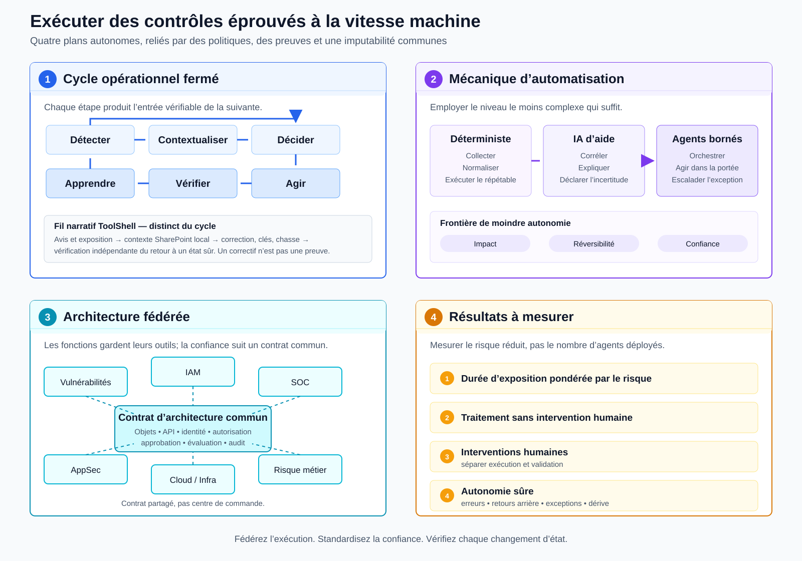

*Les modèles cyber autonomes changent la vitesse et l’échelle du problème. La réponse n’est pas un nouveau cadre de contrôles, mais un nouveau système pour exécuter ceux auxquels nous faisons déjà confiance.*

Dans [l’explorateur interactif d’Epoch AI](https://epoch.ai/data/cve?view=graph), la courbe des CVE publiées présente une rupture visuelle autour de l’annonce de Claude Mythos Preview. La tentation est forte d’y voir le début d’une vague de compromissions alimentée par l’IA. Ce serait aller plus loin que les données.

> **Figure 1 — Publications de vulnérabilités et jalon Mythos.** [Explorer la visualisation interactive d’Epoch AI](https://epoch.ai/data/cve?view=graph). Les dates représentent la publication des CVE, pas leur découverte ni leur exploitation. Les pratiques des autorités de numérotation des CVE varient et introduisent du bruit. **Crédit : Epoch AI, « Data on Cyber Vulnerabilities », CC BY 4.0, consulté le 26 août 2026.**

Ce graphique est un signal, pas une courbe des compromissions. Une CVE publiée n’équivaut pas à une vulnérabilité nouvellement découverte; une découverte n’équivaut pas à une exploitation; un exploit démontré en laboratoire n’équivaut pas à une exploitation massive dans la nature. Epoch dit d’ailleurs que le saut coïncide avec Mythos, sans lui attribuer une causalité unique.

Le [contrepoint de VulnCheck](https://www.vulncheck.com/blog/state-of-exploitation-1h-2026) est essentiel : au premier semestre de 2026, seules 14 des 1 061 vulnérabilités attribuées à une découverte assistée par IA étaient confirmées comme exploitées dans la nature, soit 1,3 %, un taux proche du taux global observé. En revanche, le délai médian entre publication et classement comme vulnérabilité exploitée connue est passé de 120 jours en 2025 à 80 jours au premier semestre de 2026.

Le problème réel combine donc davantage de signal à traiter et moins de temps pour déterminer ce qui compte. Les principes de sécurité ne sont pas devenus obsolètes. Le modèle humain, séquentiel et fondé sur les files d’attente qui les exécute est en train de le devenir. ToolShell montre pourquoi; une boucle fermée, une autonomie graduée et des analystes mieux positionnés indiquent comment changer.

## Mythos marque un seuil, pas une cause unique

Mythos importe moins comme produit que comme preuve qu’un seuil a été franchi. Dans son [évaluation de Claude Mythos Preview](https://www.anthropic.com/research/mythos-preview), Anthropic rapporte que le modèle peut découvrir puis exploiter des vulnérabilités zero-day dans des bancs d’essai et automatiser certains travaux sans intervention humaine après l’instruction initiale. Ce sont des résultats publiés par le laboratoire, dans les conditions qu’il décrit, et non la preuve que tous les modèles peuvent conduire de façon autonome une opération cyber complète contre n’importe quelle cible réelle.

Un élément public permet néanmoins de dépasser la seule affirmation générale. L’[avis FreeBSD-SA-26:08](https://www.freebsd.org/security/advisories/FreeBSD-SA-26:08.rpcsec_gss.asc) crédite « Nicholas Carlini using Claude, Anthropic » pour CVE-2026-4747. La validation insuffisante d’un paquet RPCSEC_GSS peut provoquer un débordement de pile et permettre l’exécution de code à distance lorsque les composants et conditions techniques précisés dans l’avis sont réunis.

Une [prépublication de recherche sur CVE-Genie](https://arxiv.org/html/2509.01835v2) illustre l’autre côté du changement : la reproduction. Le système multiagent a reproduit 428 vulnérabilités sur 841 avec des exploits vérifiables, soit environ 51 %. Les auteurs rapportent un coût moyen de 2,77 $ US par CVE sur l’ensemble de l’évaluation et environ 18 minutes pour une reproduction réussie. Ce résultat n’efface ni les échecs ni la nécessité de vérifier les artefacts; il montre que le coût d’une tâche auparavant très spécialisée peut diminuer fortement.

Le phénomène ne se limite pas à Anthropic. Dans sa [fiche de sécurité de déploiement](https://deploymentsafety.openai.com/gpt-5-5/cybersecurity), OpenAI classe GPT-5.5 au niveau de capacité cyber « High », mais sous le seuil « Critical » de son propre Preparedness Framework. Là encore, la classification appartient au laboratoire et à son cadre d’évaluation.

Deux chocs se dessinent : davantage de vulnérabilités peuvent être découvertes ou reproduites, et le coût comme le délai entre une information publique et un exploit fonctionnel diminuent. Le problème du défenseur devient une asymétrie de débit et de temps.

## Le goulot n’est pas notre connaissance des contrôles

Le titre ne signifie pas que le « quoi » est inutile. Il signifie qu’il ne suffit plus à différencier les organisations. Les résultats recherchés sont connus : comprendre les actifs, leurs dépendances et leurs chemins d’exposition; réduire l’accès par le *least privilege* — le moindre privilège —, la segmentation et les principes **Zero Trust**; corriger ou compenser les faiblesses; détecter, contenir, puis prouver le retour à un état sûr.

Nous ne manquons pas de principes de sécurité. Nous manquons d’un système capable de les exécuter à l’échelle machine.

Aujourd’hui, une exposition passe encore souvent par une collecte périodique, un enrichissement manuel, la recherche du propriétaire, l’ouverture d’un ticket, plusieurs transferts, un arbitrage fondé sur le CVSS et un SLA, une approbation, une correction, une vérification et enfin une fermeture. Chaque file est raisonnable isolément. Leur somme transforme la latence organisationnelle en durée d’exposition.

La réponse n’est pas de « tout corriger plus vite ». La décision doit combiner le statut d’exploitation, la criticité métier, l’exposition, le chemin d’attaque et les contrôles compensatoires. Le [modèle SSVC présenté par CISA](https://www.cisa.gov/resources-tools/resources/stakeholder-specific-vulnerability-categorization-ssvc) est un exemple reconnu : il associe des éléments de contexte à des actions de réponse cohérentes avec des priorités approuvées par la direction.

Les analystes devraient analyser les exceptions, façonner les politiques et valider les résultats — pas servir de techniciens qui cliquent dans des processus prévisibles.

## ToolShell : un correctif n’est pas un état sûr

ToolShell rend le défaut d’exécution concret. Il s’agit d’une chaîne de vulnérabilités visant des serveurs SharePoint locaux exposés. [CISA](https://www.cisa.gov/news-events/alerts/2025/07/20/update-microsoft-releases-guidance-exploitation-sharepoint-vulnerabilities) a décrit une exploitation active donnant accès au contenu et à la configuration, permettant l’exécution de code et pouvant mener au vol de clés machine, à la persistance et, dans certains cas, au déploiement d’un rançongiciel. [Microsoft](https://www.microsoft.com/en-us/security/blog/2025/07/22/disrupting-active-exploitation-of-on-premises-sharepoint-vulnerabilities) a observé plusieurs acteurs et des activités post-exploitation.

ToolShell n’est pas présenté ici comme un incident causé ou exécuté par l’IA. Il illustre le problème d’exécution actuel que l’accélération des capacités rendra plus difficile.

Répondre correctement exigeait de coordonner plusieurs actions : identifier les instances, versions, expositions et propriétaires; appliquer les mises à jour pertinentes; activer ou vérifier AMSI, l’antivirus et l’EDR; retirer temporairement de l’exposition les systèmes impossibles à protéger; effectuer la rotation des clés ASP.NET puis redémarrer IIS; rechercher les indicateurs de compromission et les modules persistants; enfin, confirmer le retour réel à un état sûr.

Cette séquence traverse la gestion des vulnérabilités, l’infrastructure, le réseau, l’IAM, le SOC, le propriétaire applicatif et le risque métier. Un ticket assigné à une seule équipe ne porte ni tout le contexte ni toute l’autorité nécessaire. De plus, un serveur à jour peut demeurer compromis si des clés ont été volées ou si une charge persistante n’a pas été éliminée.

Un correctif est un artefact. La remédiation est un changement d’état vérifié. La réponse n’est pas un ticket plus intelligent. C’est une boucle d’exécution fermée.

## Fermer la boucle d’exécution

*Figure 2 — Un modèle d’exécution qui relie le cycle opérationnel, trois mécanismes d’automatisation, une architecture fédérée et les résultats à mesurer.*

Cette boucle ne remplace pas les contrôles : elle les relie aux données, aux décisions, aux actions et aux preuves.

### 1. Détecter

L’organisation ingère en continu, par des mécanismes déterministes, les CVE, catalogues KEV, avis, télémétries, inventaires et changements d’exposition. L’IA peut résumer et dédupliquer, mais elle ne doit jamais masquer la provenance. Pour ToolShell, les avis, versions touchées et signes d’exploitation entrent dans le même flux traçable.

### 2. Contextualiser

Le signal est relié aux actifs, expositions, identités, chemins d’attaque, contrôles compensatoires, données et services métier. L’IA assemble et explique ce contexte, signale ce qui manque et déclare son incertitude. Dans le cas ToolShell, elle distingue SharePoint Online des serveurs locaux, vérifie l’exposition et trouve le propriétaire responsable.

### 3. Décider

Des politiques et seuils approuvés s’appliquent au risque contextualisé. La décision choisit entre surveiller, mitiger, confiner, corriger ou accepter temporairement, et fixe simultanément le niveau d’autonomie permis. Pour ToolShell, le contexte détermine s’il faut retirer l’exposition, corriger, faire la rotation des clés et lancer une chasse — souvent plusieurs de ces actions ensemble.

### 4. Agir

Les actions préautorisées, réversibles et à faible rayon d’impact peuvent s’exécuter automatiquement. Des agents bornés orchestrent les systèmes et fonctions concernés dans une portée explicite. L’approbation humaine demeure pour les changements à fort impact, difficiles à inverser ou dont le résultat est insuffisamment fiable. Exiger une approbation universelle recréerait toutefois le goulot que l’on cherche à éliminer.

### 5. Vérifier

Un mécanisme indépendant confirme le correctif, la disparition de l’exposition, la rotation des clés, le fonctionnement du service et le traitement des indicateurs. Il produit des preuves et une chaîne d’audit. L’agent qui agit ne peut pas être l’unique juge de son succès : la séparation entre action et vérification protège contre l’erreur comme contre l’optimisme automatique.

### 6. Apprendre

Résultats, exceptions, erreurs et retours arrière alimentent les politiques, tests, données et évaluations. Un humain valide les changements significatifs aux règles. Chaque incident améliore ainsi le système au lieu de produire seulement un ticket fermé et une connaissance perdue dans sa chronologie.

L’automatisation ne supprime pas le contrôle. Elle le déplace des clics individuels vers les politiques, l’architecture et la vérification.

## Automatiser sans abandonner le contrôle

Tout n’a pas besoin d’un agent. Le modèle combine trois niveaux, et chaque étape emploie le moins complexe qui suffit.

1. **Automatisation déterministe.** Elle convient à la collecte, à la normalisation, aux règles stables et aux actions répétables dont les entrées, sorties et échecs sont bien compris.
2. **IA d’aide à la décision.** Elle sert à corréler, synthétiser, expliquer le contexte, recommander et exprimer l’incertitude. Sa sortie doit être validée avant de devenir une action lorsque le risque l’exige.
3. **Agents bornés.** Ils orchestrent plusieurs systèmes lorsque la séquence dépend du contexte, mais avec une portée, des outils, des droits, un budget et des conditions d’arrêt explicites.

L’« agentique » n’est pas une finalité. Le principe directeur est celui de la **moindre autonomie**, ou *least agency*, en complément du moindre privilège. Le moindre privilège limite ce qu’un agent peut atteindre. La moindre autonomie limite ce qu’il peut décider et faire seul. La frontière n’est pas fixée par l’enthousiasme technologique, mais par trois critères : **impact, réversibilité et confiance**.

L’architecture qui soutient ce modèle doit être fédérée. Le SOC, l’IAM, l’AppSec, le nuage, l’infrastructure et la gestion de l’exposition conservent leurs outils, leurs automatisations, leurs agents et leurs priorités. Ils partagent toutefois un contrat d’architecture commun : objets communs; API et événements versionnés; identité et autorisation des agents; mécanismes d’approbation; évaluations; observabilité et audit. La trace rattache chaque action à l’initiateur humain et/ou au propriétaire métier et conserve toute la chaîne de délégation entre agents.

Cette autonomie introduit ses propres risques : provenance incertaine, injection d’instructions, permissions excessives, sorties non validées, propagation d’erreurs et dépendances compromises. Le [Top 10 d’OWASP pour les applications agentiques](https://genai.owasp.org/resource/owasp-top-10-for-agentic-applications-for-2026) offre un point de départ opérationnel; le [cadre AI RMF du NIST](https://www.nist.gov/itl/ai-risk-management-framework) structure la gouvernance, la mesure, l’évaluation et la gestion du risque lié à l’IA.

> **Garde-fous minimaux** — Identité machine distincte; autorisations minimales et temporaires; séparation entre recommandation, action et vérification; journalisation inviolable; évaluations continues; validation des sorties; retour arrière testé; arrêt contrôlé. Aucun agent ne reçoit plus de portée que son scénario ne l’exige.

Fédérez l’exécution. Standardisez la confiance.

## Mesurer le déplacement du travail

L’objectif n’est pas de retirer les analystes. C’est de cesser de les utiliser comme moteurs manuels de processus.

Le travail doit se déplacer : moins de collecte, de copie, de triage répétitif, de tickets et de vérification manuelle; davantage d’analyse d’exception, de conception de politiques, de validation, de simulation et d’investigation complexe. L’expertise humaine intervient là où elle change réellement la qualité de la décision, au lieu d’être diluée dans chaque transfert.

Quatre indicateurs rendent ce déplacement observable :

1. **La durée d’exposition pondérée par le risque métier**, pour mesurer le temps réellement subi plutôt qu’un simple délai de fermeture.
2. **Le taux de traitement sans intervention humaine**, de la détection à la preuve, dans les scénarios autorisés.
3. **Les touches ou minutes humaines par exposition**, en séparant le temps d’exécution du temps de validation afin de ne pas confondre expertise et travail administratif.
4. **L’autonomie sûre**, suivie par les erreurs, retours arrière, exceptions et signes de dérive.

Aucune métrique ne suffit seule. Un taux élevé d’automatisation qui ne réduit pas l’exposition, ou qui repose sur des décisions dangereuses, est un échec. Une baisse des interventions humaines qui fait disparaître la validation indépendante l’est aussi.

La conséquence budgétaire n’est pas nécessairement l’achat d’une nouvelle plateforme. Elle est un rééquilibrage vers le contexte de données, les interfaces, l’automatisation, les politiques explicites, l’identité machine, les évaluations et l’observabilité. Le choix de construire ou d’acheter reste secondaire par rapport à la capacité de démontrer le résultat.

Le jugement humain doit devenir plus concentré, pas plus dilué.

## Références principales

- [Epoch AI — *Data on Cyber Vulnerabilities*](https://epoch.ai/data/cve?view=graph)
- [Anthropic — *Assessing Claude Mythos Preview’s cybersecurity capabilities*](https://www.anthropic.com/research/mythos-preview)
- [OpenAI — *GPT-5.5 System Card: Cybersecurity*](https://deploymentsafety.openai.com/gpt-5-5/cybersecurity)
- [VulnCheck — *State of Exploitation 1H-2026*](https://www.vulncheck.com/blog/state-of-exploitation-1h-2026)
- [CISA et Microsoft — recommandations ToolShell](https://www.cisa.gov/news-events/alerts/2025/07/20/update-microsoft-releases-guidance-exploitation-sharepoint-vulnerabilities)
- [CVE-Genie — prépublication et artefacts de reproduction](https://arxiv.org/html/2509.01835v2)

## Trois questions pour le CISO

Mythos est un jalon, pas une explication unique. L’augmentation du débit de découverte et de reproduction ne signifie pas que chaque vulnérabilité deviendra une attaque. Elle comprime néanmoins le temps disponible pour distinguer le bruit du risque, décider et agir. Les contrôles éprouvés demeurent; c’est leur modèle d’exécution, trop séquentiel et trop dépendant des files humaines, qui doit changer.

1. **Où la latence humaine crée-t-elle le plus de risque dans nos opérations cyber?**

2. **Quelles décisions et actions pouvons-nous déléguer dès maintenant de façon sûre, compte tenu de leur impact, de leur réversibilité et de notre niveau de confiance?**

3. **Investissons-nous dans davantage de contrôles, ou dans un système d’exécution qui réduit le travail manuel et raccourcit de façon mesurable la durée d’exposition?**

Dans l’ère post-Mythos, les organisations cyber les plus fortes ne seront pas celles qui possèdent le plus long catalogue de contrôles, mais celles qui sauront exécuter des contrôles éprouvés à la vitesse machine sans renoncer à l’imputabilité.
